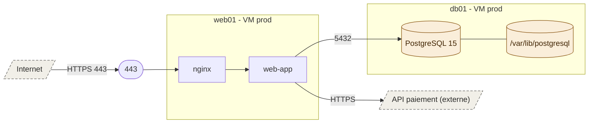

# Mermaid rules

One bad character breaks a whole diagram, and the reader then sees raw code instead of a graph. Follow these rules; `scripts/validate_output.py` checks the common ones.

## Syntax
- Declare `flowchart LR` (or `TB` for deep stacks). Do not use the older `graph` keyword.
- Node ids: ASCII letters, digits, underscore only. Never use `end`, `graph`, `subgraph`, `class`, `style`, `click` as ids.
- **Always quote labels** that contain spaces, parentheses, slashes, colons, dots or accents: `web01["web01 (nginx)"]`.
- Line breaks inside labels: `<br/>`, never `\n`.
- Edge labels: `A -->|"HTTPS 443"| B`. Quote them too.
- Every `subgraph` needs a matching `end`. Give subgraphs an id and a quoted title: `subgraph prod["Production"]`.
- Do not put secrets, full URIs with credentials or raw IPs of unknown sensitivity in labels. Host and port are fine.
- Keep a diagram under about 25 nodes; split by environment or layer.

## Shapes (use consistently across all diagrams)
| Entity | Shape | Example |
|---|---|---|
| Machine / host | subgraph | `subgraph web01["web01<br/>VM prod"]` |
| Service / container | rectangle | `nginx["nginx"]` |
| Disk / volume / bucket | folder-like cylinder via `[("...")]` | `vol1[("/var/lib/postgresql<br/>volume")]` |
| Database | cylinder | `pg[("PostgreSQL 15")]` |
| Inbound door | stadium | `in443(["HTTPS 443"])` |
| External actor | parallelogram | `partner[/"Partenaire SFTP"/]` |

## Styling
Define classes once at the bottom of each diagram and reuse them:

```
classDef internal fill:#E6F1FB,stroke:#185FA5,color:#042C53
classDef storage fill:#FAEEDA,stroke:#854F0B,color:#412402
classDef external fill:#F1EFE8,stroke:#5F5E5A,color:#2C2C2A,stroke-dasharray:5 3
classDef inbound fill:#E1F5EE,stroke:#0F6E56,color:#04342C
class pg,vol1 storage
class partner external
```

Dashed borders mean "outside this infra". Dark text on light fills keeps both light and dark themes readable.

## Minimal complete example

